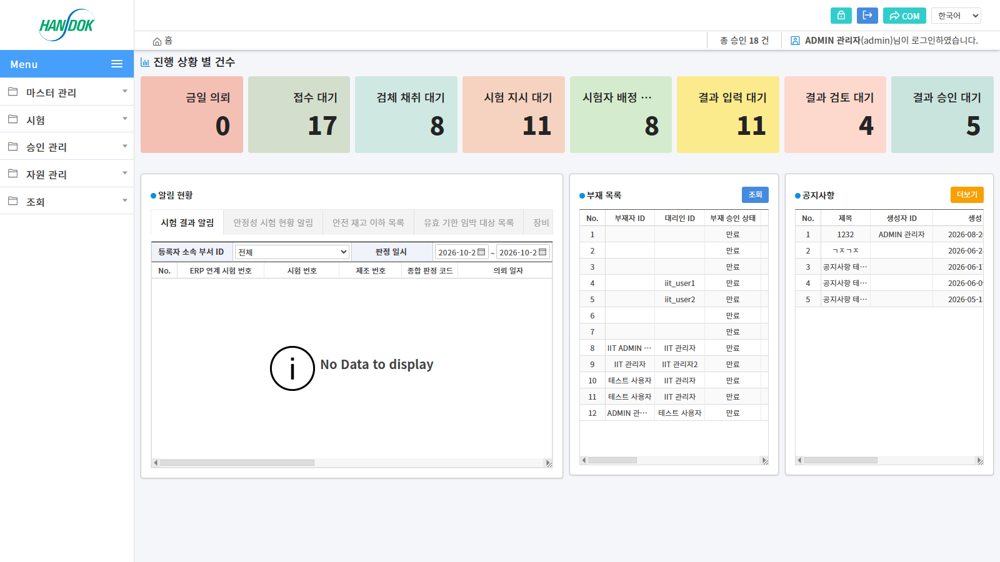

# TeO's portfolio
## :pushpin: 목차
> 📝 [Intro](#Intro)  
> 🔨 [Skill](#Skill)  
> 💬 [Conatct](#Contact)  
> ✨ [Company Projects](#projects1)  
> ✨ [Personal Projects](#projects2)  
> 🔎 [Etc](#Etc)  

## :pushpin: Intro

### 기본 정보
- **이름**: 김 태호
- **생년월일**: 1992.10.05 (만 33세)
- **최종학위**: 국민대학교 식품영양학
- **개발경력**: 2023.06 ~ (3년)

### 자격증
- 정보처리기사
- 네트워크관리사2급
- e-test professional

### 교육활동
- 이젠컴퓨터아카데미 Java Full Stack (22.12.30~23.05.25, 800시간)
- 멘티 활동 (23.11.01~24.05.31)
  - 내용: 웹개발 프로그램에 필요한 서적 회독 및 소규모 프로젝트 진행
  - 서적: 컴퓨터 구조 및 운영체제, 객체지향 사고프로세스, 객체지향의 사실과 오해, 오브젝트, 좋은 코드/나쁜 코드, 읽기 좋은 코드가 좋은 코드다, 도메인 주도 개발 시작하기
- 멘토 활동 (24.06.01~24.11.15)
  - 내용: 웹 프로그래밍 수강하는 학생을 대상으로 팀 프로젝트(Ecommerce Web) 1건 멘토링 진행

 

## :pushpin: Skill 

### Backend
- **Language**: Java (8, 11, 17)
- **Framework**: Spring Framework 4.x, Spring Boot 2.x/3.x, Spring MVC
- **ORM/Persistence**: MyBatis, Spring Data JPA, QueryDSL 5.0
- **Security**: Spring Security, JWT (JJWT)
- **API**: RESTful API, Swagger/OpenAPI
- **Testing**: JUnit 4/5, Spring REST Docs, Jacoco

### Database & Migration
- **RDBMS**: MySQL, Oracle, PostgreSQL, MS SQL, H2
- **Migration**: Flyway, Liquibasae

### Frontend
- **Core**: HTML5, CSS3, JavaScript, TypeScript
- **Framework/Library**: React.js, Next.js, Vue.js, jQuery
- **Template**: JSP, JSTL
- **Editor**: Summernote

### DevOps & Tools
- **AI**: claude, gemini, openAI, genspark, noteGPT
- **Build**: Maven, Gradle
- **VCS**: GitHub, Gitea, SVN
- **IDE**: cursor, IntelliJ IDEA, Eclipse
- **Server**: Tomcat
- **Middleware**: Apache
- **Container/IaC**: Docker, Terraform

### Cloud (GCP)
- **Compute**: GKE 기반 컨테이너 서비스 운영, Compute Engine VM 구성
- **Serverless**:Cloud Run을 활용한 경량 API 서비스 배포
- **Database**: Cloud SQL (MySQL/PostgreSQL) 운영 및 백업 관리
- **DevOps**: GitHub Actions 기반 CI/CD 파이프라인 구축
- **Monitoring**: Cloud Monitoring / Logging 기반 서비스 관측 및 알림 설정
- **Security**: IAM / Service Account 권한 설계

### Additional Skills
- Domain-Driven Design (DDD)
- Clean Architecture
- Python (자동화 봇 / LLM 챗봇 / Gradio)

 

## :pushpin: Contact
- 이메일: hokeng92@naver.com
- 깃허브: https://github.com/Tea-ho

 

## :pushpin: Company Projects
### 1. [한독]
> **LIMS 프로젝트: 실험실 정보관리 시스템 웹 전환 (.NET → Java)**  
>
> **담당업무:**  
> - 기존 .NET LIMS(팜메이트) 품질시험 프로세스를 Java 웹으로 이식 (의뢰 → 지시 → 검체채취 → 접수 → 배정 → 결과입력 → 중간검토 → 결과승인) 
> - 워크플로우 정의·단계 전이 엔진 구현 (반려·재시험 차수·강제종료·결재선 자동 선택) 
> - 안정성 시험 계획서·보고서 재설계 및 주기별 시험 자동 생성 스케줄러 구현 
> - 검체 도메인 재설계 (입고·출고·반납·사용·폐기 원장, 검체관리대장) 
> - 품목·규격서 버전 관리 및 자동개정(승인/시행 분리, 시행일자 자동 조정) 
> - DDD/CQRS 계층 구조(Command/Query 분리, Policy 기반 도메인 규칙) 적용, Liquibase 스키마 관리 
>
> **개발기간:** 2026.01 ~ (진행중) 
>
> **기술 스택:**  
> Java 11 / Spring Boot / eGovFrame 4.3 / MyBatis (MPA) / Liquibase / MS SQL  
> JSP / JavaScript(ES6 Module) / AUIGrid / Gitea (PR 기반 협업)
>
> 
---

### 2. [한국바이오켐제약]
> **LIMS 프로젝트: 실험실 정보관리 시스템**  
>
> **담당업무:**  
> - 웹사이트 메인 프론트엔드/백엔드 개발 및 배포 (Spring MVC 기반) 
> - Oracle DB 설계·세팅 및 Mybatis 매핑 주도 
> - 프로젝트 초기 환경 세팅 및 형상관리(SVN) 리딩 
> - 로깅 Error 레벨 이상 시 실시간 이메일 알림 기능 구현 (개인프로젝트 universal-logging-java 이용) 
> - Quartz 스케줄러 개발 (안정성 시험 자동 실행, 장비 주기점검 관리) 
> - ERP 시스템과의 DB-to-DB 실시간 연계 (ERP 품목, 거래처, 유저, 시험의뢰 데이터 동기화 배치) 
> - Oracle DB 스케줄러 + PL/SQL Procedure 활용으로 ERP Quartz 부분 이중화 및 장애 최소화 
> - 시험 결과값, 시험일지 엑셀 파일에 자동 매핑 기능 구현 
>
> **개발기간:** 2024.01 ~ 2025.12 (2년) 
>
> **기술 스택:**  
> Java 11 / Spring Framework / Mybatis / Quartz Scheduler /  
> Oracle DB (PL/SQL, Procedure, Job Scheduler) /  
> HTML5 / CSS3 / JavaScript(ES6) / Spread.JS / AUIGrid /  
> Apache POI (Excel Import/Export) / FindBugs (정적 분석) / Java Mail API / Logback + SLF4J
>
> 
---

### 3. [신세계백화점]
> **LIMS 프로젝트: 실험실 정보관리 시스템**  
>
> **담당업무:**  
> - 대용량 Excel(Apache POI) Import/Export 고도화 및 데이터 무결성 검증 로직 구현 (시험 데이터 일괄 등록) 
> - CubeOne 암호화 API 전사 적용 및 보안 인증 (개인정보/민감 데이터 column-level 암호화)  
> - FindBugs 정적 분석 도구를 활용한 코드 품질 관리  
> - Spring Boot 기반 RESTful CRUD API 설계 및 트랜잭션 관리  
>
> **개발기간:** 2023.10 ~ 2024.03 (5개월) 
>
> **기술 스택:**  
> Java 8 / OracleDB / Mybatis / SpringBoot  
> HTML5 / CSS / JS / Spread.js(API) / AUIGrid(API) / CUBEONE (API) / FindBug(API)
>
> 
---

### 4. [DTNC]
> **LIMS 프로젝트: 실험실 정보관리 시스템**  
>
> **담당업무:**  
> - 사용자 권한 기능 추가 (유저별 권한 도입 / 권한에 따른 메뉴 접근)  
> - Spring Boot 기반 RESTful CRUD API 설계 및 트랜잭션 관리  
>
> **개발기간:** 2023.07 ~ 2023.12 (6개월) 
>
> **기술 스택:**  
> Java 8 / OracleDB / Mybatis / SpringBoot  
> HTML5 / CSS / JS / Spread.js / AUIGrid(API)
> 
> 
---

 

## :pushpin: Personal Projects
### 1. [GMP RAG Chatbot (GMP 가이던스 챗봇)](https://gmp.howhow.kr/)
>완제의약품 제조 및 품질관리기준(GMP) 가이던스 PDF를 기반으로 답변하는 로컬 RAG 챗봇
>
>**개발 기간:** 2026.03 ~ (진행중)
>
>**기술 스택:**
>임베딩/LLM: Ollama (로컬 추론, 외부 API 호출 없음), 벡터 DB: FAISS (로컬 파일), UI: Gradio, 언어: 한국어
>
>**주요 기능:**
>- GMP 가이던스 문서 인덱싱 및 자연어 질의응답
>- 규제·품질 관련 도메인 특화 답변
>- Gradio 기반 챗봇 인터페이스 제공
>
>**개발 특징:**
>- 도메인(제약/품질) 특화 LLM 챗봇 구축
>- 로컬 환경에서 손쉽게 실행 가능한 경량 구성 (Gradio + Batchfile)
>- 로컬 환경 자원(VRAM 4GB, 디스크 99GB)

---

### 2. [Gloria (글로리아) — 마케팅 자동화 봇 데스크탑 앱](https://gloria.ai.kr/)
>블로그·SNS·커머스 마케팅 업무를 자동화하는 봇들을 하나의 데스크탑 앱에서 구독식으로 제공하는 서비스 (2인 팀 프로젝트, 실서비스 운영)
>
>**개발 기간:** 2026.05 ~ (진행중)
>
>**기술 스택:**
>**Desktop:** Tauri 2.0 / React / TypeScript / Tailwind CSS / shadcn/ui / react-flow 
>**Automation:** Node.js / Playwright (브라우저 자동화) / SQLite 
>**Backend/Infra:** Cloudflare Workers · Pages · KV · R2 (라이선스 API, 랜딩, 프록시) 
>**Monorepo:** pnpm workspace (공통 패키지 34개 + 봇별 독립 패키지) / GitHub Actions (self-hosted runner)
>
>**담당 업무:**
>- **데스크탑 앱:** 전 봇 실행 이력 시스템 및 audit trail 사용자 귀속, 관리자 도구(로그 뷰어·백업·라이선스 해제)
>- **봇 간 워크플로우:** 실행 결과를 [다음 봇으로 보내기]로 연계, react-flow 기반 워크플로우 노드 캔버스 편집
>- **네트워크:** 프록시 설정 단일화(같은 IP 다계정 차단), USB 테더링 폰 IP 회전 서비스 및 실행 전 판정
>- **엑셀 입출력:** 공통 빌더로 결과 보고서·업로드 양식 전면 개편 (한글 열 사전, 검증·안내 시트)
>- **외부 API 의존 제거:** YouTube Data API → 무키 크롤링 전환, 메일 SendGrid/OAuth → SMTP 전환
>- **SNS 봇 UX:** 장시간 실행 봇 SSE 진행률, 실행 취소, 계정·명단 칩 입력 및 자동완성
>- **랜딩 페이지(gloria.ai.kr):** 서류함 컨셉 홈, 봇 카탈로그 본문 검색(Ctrl+K), OG 이미지·브랜드 로고 적용
>
>**개발 특징:**
>- 봇마다 독립 패키지 + manifest 기반 레지스트리로 앱/랜딩의 봇 목록·분류를 단일 출처화
>- PR 기반 협업 (feature 브랜치 → CI 통과 → squash merge), dev/main 직접 push 차단

---

### 3. Meeting AI — 회의 녹음 AI 보고서
>회의 녹음 파일을 로컬에서 전사·화자 분리한 뒤, 요약·결정 사항·액션 아이템을 근거 타임스탬프와 함께 보고서로 만들어 주는 파이프라인
>
>**개발 기간:** 2026.10 ~ (진행중)
>
>**기술 스택:**
>Python 3.12 / uv / faster-whisper (large-v3-turbo, int8 CPU) / sherpa-onnx (화자 분리) 
>Claude (보고서 생성) / RapidFuzz / Notion API
>
>**주요 기능:**
>- 녹음 → 전사 → 화자 분리 → 보고서(`report.md`/`report.json`) 자동 생성, 모든 항목에 근거 타임스탬프 첨부
>- 폴더 감시 자동 처리: 녹음 파일이 들어오면 처리 후 노션 전달 + OS 알림
>- 조직별 프로필: 용어 사전·보고서 양식(표준/품목별 표)·전달처를 조직·프로젝트 단위로 분리
>- 직접 작성한 회의 메모를 정답으로 삼고 녹음으로 맥락을 보충한 통합본 생성
>- 처리 시간·비용·근거 없는 항목 수를 `metrics.json`으로 기록
>
>**개발 특징 / 성과:**
>- 한국어 CER 4.98% (목표 ≤10%), 보고서 생성 1건당 약 $0.02~0.03
>- 원거리 녹음에서 VAD가 발화를 통째로 누락하는 문제 → 장시간 공백 구간만 VAD 없이 재전사 + 반복·무음 필터로 복구
>- 47분 실회의 전사 시간 3,008초 → 1,891초 (RTF 1.06 → 0.67)
>- Whisper 반복 루프(같은 문장 최대 37회) 감지 시 해당 구간만 재전사해 제거

---

### 4. [Coremax Web](http://www.coremaxtech.com/)
>기업 홈페이지 웹 애플리케이션 - 회사 소개, 솔루션 안내, 고객센터 기능을 제공하는 종합 기업 웹사이트 (프리랜서 프로젝트)
>
>**개발 기간:** 2025.03 ~ 2025.04 (2개월)
>
>**기술 스택:**
>Java 8 / Spring Framework 4.3.8 / MyBatis / MySQL 
>JSP / JSTL / jQuery / Summernote Editor 
>Maven / Commons FileUpload / JavaMail
>
>**주요 기능:**
>- **회사소개**: 회사정보, CI&BI, CEO 인사말, 연혁, 오시는 길, Mission & Vision, 인증 & 특허
>- **사업소개**: 솔루션 연구개발, 컨설팅, NI/SI 구축, 통합유지보수
>- **솔루션 안내**: SDNS, UDSS, EPM, SSL-VPN, 내PC지키미, SDNS-EMS
>- **고객센터**
>  - 공지사항, 인재채용, 보도자료 게시판 (CRUD, 페이징, 검색)
>  - 자료실 (파일 업로드/다운로드)
>  - QnA (비밀번호 보호, 댓글 기능, 이메일 자동 발송)
>- 관리자 로그인 및 권한 관리
>- Summernote WYSIWYG 에디터 이미지 업로드
>- 이메일 발송 시스템
>
>**개발 특징:**
>- DAO 패턴 기반 데이터 접근 계층
>- Service 계층 분리를 통한 비즈니스 로직 관리
>- 파일 업로드 처리 (UUID 기반 파일명 관리)
>- 페이징 및 검색 기능 구현
>- RESTful API 스타일 컨트롤러 설계

---

### 5. [Universal Logger (Java)](https://github.com/Tea-ho/universal-logger-java)
>범용 로깅 라이브러리 - SLF4J 기반으로 다양한 애플리케이션에서 사용 가능한 확장 가능한 로깅 솔루션 (개인 학습 프로젝트)
>
>**개발 기간:** 2025.06 ~ 2025.09 (3개월)
>
>**기술 스택:**
>Java 8 / Java 11(11+ 호환용 버전) / SLF4J 1.7.36 / Logback 1.2.12 
>Jackson / SnakeYAML / Apache HttpClient 4.5 / JavaMail API 
>Gradle Shadow Plugin (Fat JAR)
>
>**주요 기능:**
>- **다중 Appender 지원**
>  - 데이터베이스 Appender (MySQL, Oracle, MS SQL, PostgreSQL, H2)
>  - Webhook Appender (HTTP POST)
>  - Email Appender
>- 컬러 포매터 및 커스텀 로그 포맷 지원
>- 메시지 필터링 기능
>- Spring Boot Auto-Configuration 지원
>- YAML 기반 설정 관리
>- SQL 쿼리 자동 캡처 (DataSource Proxy)
>
>**아키텍처 특징:**
>- Factory 패턴 기반 데이터베이스 연결 관리
>- Strategy 패턴 기반 Appender 설계
>- Spring Boot Starter 제공 (`@EnableUniversalLogger`)
>- Fat JAR 배포로 쉬운 통합
>- 의존성 충돌 방지를 위한 선택적 의존성 설계
>- **Java 8 기반 개발, Java 11+ 완전 호환**
>
>**활용 사례:**
>- 회사 LIMS 프로젝트(한국바이오켐제약)에 적용 — ERROR 레벨 이상 실시간 이메일 알림
>- 다양한 환경(Web, Batch, Standalone)에서 재사용 가능

---

 

## :pushpin: Etc
- 경력사항: 일성아이에스(舊 일성신약) 생산기획팀 / 2018.10 ~ 2022.10 (4년 근무)
- 기타 자격증: 운전면허 1종 보통 / 산업안전기사 / 물류관리사 / 유통관리사2급 / 위생사 / 바리스타2급
